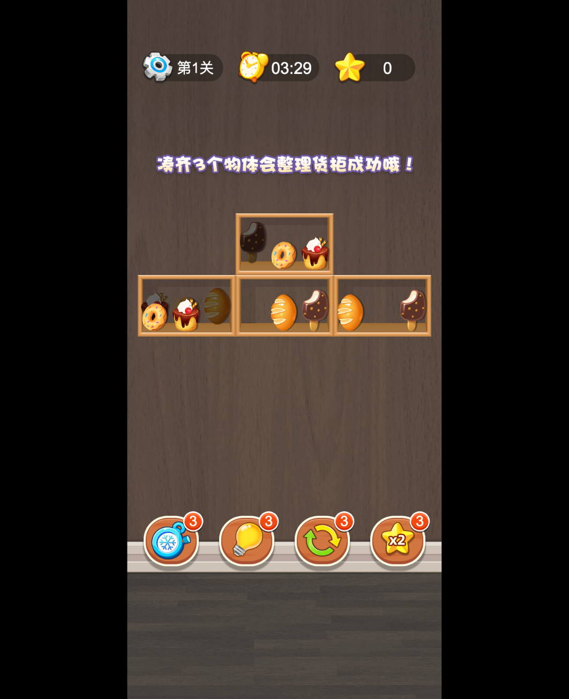

# 货柜消除大师 · Web Source

Cocos Creator **3.8.3** 货柜三消游戏的独立 Web 源码工程。运行时不需要 Creator、不需要构建，直接在工程根目录启动静态服务即可游玩。

> 状态：已通过主流程验收（2026-10-22） · 设计分辨率：720 × 1600 竖屏 · 业务源码：92 个原始 TypeScript + 95 个可读运行模块 · 运行方式：`http-server` / 任意静态 HTTP 服务



**在线试玩**：https://arisgod1.github.io/goods-match-web-source/

## 这个工程是什么

这个仓库不是 Creator 工程，也不是压缩后的 Web 构建包，而是一个可以直接阅读、修改和静态部署的 Web Source：

- `engine/` 固定 Cocos 3.8.3 运行时；
- `game/source/` 保留 92 个原始 TypeScript，作为语义权威；
- `game/modules/` 是当前可编辑的运行模块；
- `game/bundle.js` 由模块组装生成，不是手写源码；
- `data/`、`assets/`、`docs/`、`tools/` 分别承载数据、资源、文档和校验工具。

主要用途是模型训练、二次创作和静态试玩，不是继续维护原始 Creator 工程。

## 快速开始

### 环境

- Node.js 18+（仅用于启动静态服务；游戏本身是纯静态文件）
- 现代 Chrome / Edge / Safari
- `http-server`，或使用工程内的 devDependency

### 运行

```sh
# 方式 A：已全局安装 http-server
http-server . -p 8080 -c-1

# 方式 B：使用工程内依赖
npm install
npm start
```

浏览器打开 `http://127.0.0.1:8080/`。

注意：

- 不要使用 `file://` 打开 `index.html`。
- 8080 被占用时，直接执行 `http-server . -p 8081 -c-1`；换端口会得到独立存档。
- 停止服务使用 `Ctrl-C`。

## 目录结构

```text
.
├── index.html                 页面外壳
├── style.css                  页面样式
├── favicon.svg
├── boot.js                    启动器：加载 data/，再导入 game/main.js
│
├── engine/                    Cocos 3.8.3 固定运行时
│   ├── cc.js
│   ├── system.bundle.js
│   ├── polyfills.bundle.js
│   ├── import-map.json
│   └── chunks/bundle.js
│
├── game/
│   ├── main.js                SystemJS 入口
│   ├── application.js         Cocos Application 适配器
│   ├── settings.json          场景、资源包、scriptPackages、设计分辨率
│   ├── modules/               95 个可读运行模块
│   ├── modules.json           模块 / TS / UUID / 可读性映射
│   ├── prerequisite.js        SystemJS 虚拟入口注册
│   ├── bundle.js              生成文件：业务运行包
│   ├── bundle.js.map          生成文件：source map
│   └── source/                92 个原始 TypeScript 业务源码
│
├── data/
│   ├── config.json            主页、技能、金币、连击等参数
│   └── tables/                关卡、商品、奖励、登录奖励、转盘、连击表
│
├── assets/                    Cocos 资源包
│   ├── internal/
│   ├── main/                  main/index.js 是兼容占位脚本
│   ├── game/
│   ├── ui/
│   ├── icon/
│   ├── audio/
│   └── resources/
│
├── tools/
│   ├── check.cjs              结构、模块图、资源、UUID、可读性校验
│   └── assemble-game.cjs      从 game/modules 生成 bundle 与 source map
│
├── docs/                      需求、计划、架构、代码映射、编辑、验证
├── cocos-source.example.json  本机路径映射模板
├── package.json
├── package-lock.json
└── README.md
```

`cocos-source.json` 是本机私有文件，记录 Creator、原始工程和参考构建路径，已被 `.gitignore` 忽略；运行时不读取它。

## 源码层级

| 位置 | 内容 | 是否手改 |
| --- | --- | --- |
| `game/source/**/*.ts` | 92 个原始 TypeScript，语义权威 | 可以，但不会自动进入运行时 |
| `game/modules/*.js` | 95 个可读运行模块 | 可以，修改后重新组装 bundle |
| `game/bundle.js` / `bundle.js.map` | 由模块生成的运行包 | **不要手改** |
| `data/config.json`、`data/tables/*.json` | 玩法参数与表数据 | 可以，刷新即生效 |
| `assets/*/native/`、`assets/*/import/` | 图片、音频、序列化资源 | 媒体可替换；结构改动回 Creator |
| `assets/main/index.js` | Cocos 主包兼容占位脚本 | **不要手改** |
| `engine/` | 固定 Cocos 运行时 | **不要改** |
| `tools/`、`docs/` | 工具与文档 | 可以 |

## 常见编辑流程

### 改关卡、奖励、商品数据

编辑：

```text
data/tables/cfg_level.json
data/tables/cfg_icon.json
data/tables/cfg_passReward.json
data/tables/CfgLoginReward.json
data/tables/CfgLuckySpin.json
data/tables/CfgCombo.json
```

保持 JSON 合法、UTF-8、2 空格缩进。改完刷新页面即可，不需要重新生成 bundle。

### 改玩法参数

编辑 `data/config.json`：

- `home.settingsButton`：主页设置按钮位置/尺寸；
- `gameplay`：默认商品、金币、冰冻/复活时间、超时提醒、连击上限等；
- `skillIcons`：技能图标键；
- `tables`：启动时加载的表清单。

### 改运行模块

```sh
# 1. 修改 game/modules/*.js
# 2. 重新生成运行包
node tools/assemble-game.cjs
# 3. 刷新浏览器
# 4. 校验
npm test
```

必须保持模块 ID、类名、`ccclass` 名称、序列化字段和 `_RF.push` 组件 UUID 不变；不要把代码压缩或改成 `.min.js`。

### 改 TypeScript

`game/source/**/*.ts` 是阅读、检索和模型训练的第一来源，但当前没有 TS → `game/modules` 自动编译工具：

- 只改 TS 不会自动改变运行行为；
- 运行时改动优先改 `game/modules/*.js` 并重新组装；
- 后续如补编译工具，必须保持模块 ID、组件 UUID 和序列化字段不变。

### 替换图片和音频

- 图标：`assets/icon/native/`
- 玩法图片/图集：`assets/game/native/`
- 界面图片：`assets/ui/native/`
- 音乐/音效：`assets/audio/native/`
- 预加载资源：`assets/resources/native/`

尽量保持文件名和 UUID 不变。Prefab、场景、图集结构改动应回到原始 Creator 工程完成。

## 构建与校验

```sh
# 结构、资源、模块图、UUID、可读性校验
npm test
# 等同
node tools/check.cjs

# 重新生成 game/bundle.js 与 source map
node tools/assemble-game.cjs

# 只检查 bundle 是否与模块一致
node tools/assemble-game.cjs --check
```

预期结果：

- `check.cjs`：14 passed / 0 failed（缺少本地 `cocos-source.json` 时为 13 passed + 1 warning）；
- `assemble-game.cjs --check`：`bundle is up to date`；
- 浏览器 Console：0 error / 0 pageerror；
- Network：0 个 404 / failed request，外部请求 0。

## 启动链路

```text
index.html
  -> engine/polyfills.bundle.js
  -> engine/system.bundle.js
  -> engine/import-map.json (cc -> ./cc.js)
  -> boot.js
       -> data/config.json
       -> data/tables/<config.tables>.json
       -> WebGameConfig / WebGameTables
       -> game/main.js
            -> game/application.js
            -> game/settings.json
            -> engine/chunks/bundle.js
            -> game/bundle.js
            -> assets/* 资源包
            -> main.scene
```

Cocos 仍会请求 `assets/main/index.js`，它只是兼容占位脚本；业务模块由 `game/bundle.js` 统一注册。

## 存档

- 唯一键：`hgxcds_game_v1`。
- 通过 `GameSave` 事务写入。
- 存档绑定站点 origin；换端口、换域名或隐私模式会得到不同/不可用存档。
- 不提供云存档或跨设备同步。

## 验证摘要

| 项目 | 结果 |
| --- | --- |
| 结构/资源/模块校验 | 14 passed / 0 failed |
| bundle 一致性 | 96 sources，up to date |
| 浏览器主流程 | 主页、关卡、拖拽三消、技能、暂停/恢复、存档刷新、超时/复活、胜利 UI |
| Console / Network | 0 error / 0 pageerror；0 个 404 / failed；外部请求 0 |
| 数据编辑 | 首关时间 210 → 999 后计时器显示 `16:38`，无需重建 |
| 缺失 `cocos-source.json` | 仍可完整运行，check 仅 warning |

详细记录见 [docs/validation.md](docs/validation.md)。

## 已知限制

- 92 个运行模块仍是 Babel 编译产物，局部变量为编译器短名；`game/source/` 的 TypeScript 是权威可读源码，运行时 JS 非压缩且带 source map。
- 当前没有 TS → `game/modules` 自动编译工具。
- 超时/胜利 UI 通过 Stage 状态方法触发正常 UI 链路，没有等待自然超时或完整自然通关。
- 未单独点击胜利/暂停的返回按钮；返回主页通过刷新验证；重新开始和实体手机未单独验收。
- 桌面 Chrome headless 验证，不是移动端真机验收。
- Prefab、场景、图集等结构性资源修改仍需回到原始 Creator 工程。
- `assets/main/index.js` 是 Cocos 主包预加载兼容占位脚本，不承载业务代码。

## 常见问题

| 现象 | 排查 |
| --- | --- |
| 页面白屏或启动失败提示 | 看提示中的 URL/HTTP 状态；检查 `data/` 文件是否存在 |
| 模块缺失或组件不挂载 | 运行 `node tools/check.cjs`；确认 `game/modules.json` 和 `game/bundle.js` 已同步 |
| 改了 JS 但页面没变化 | 是否执行 `node tools/assemble-game.cjs`；强制刷新/禁用缓存 |
| 改了 TS 但页面没变化 | 当前 TS 不参与运行；同步到 `game/modules/` 或等待编译工具 |
| 资源 404 | 检查 `assets/<bundle>/config.json` 与 `native/`/`import/` 路径；不要改 UUID |
| 存档丢失 | 检查端口/域名/隐私模式；确认键仍是 `hgxcds_game_v1` |
| 音频没声音 | 先点击页面产生用户手势；浏览器自动播放策略限制 |
| `cocos-source.json` 缺失 | 不影响运行；复制 `cocos-source.example.json` 填写本机路径即可 |


## GitHub Pages 发布

本仓库沿用原项目 `goods-match` 的发布方式：`main` 分支根目录 + `.nojekyll`，GitHub Pages legacy 构建。推送 `main` 后自动发布根目录静态文件；不需要 GitHub Actions，也不需要 GitHub 运行 Creator。

- 在线地址：https://arisgod1.github.io/goods-match-web-source/
- 源码、文档和验收证据保留在同一仓库，便于训练和二次创作。

## 文档

- [需求文档](docs/requirements.md)
- [执行计划与任务记录](docs/implementation-plan.md)
- [架构与运行链路](docs/architecture.md)
- [代码映射](docs/code-map.md)
- [二次创作与编辑指南](docs/editing.md)
- [验证记录](docs/validation.md)

## 使用说明

- 本工程不包含广告、支付、登录、排行榜或服务端接口。
- 原始游戏内容、美术和音频资源的使用需遵守原项目授权。
- 代码按真实行为和可读性组织，校验脚本只作为结构和完整性护栏，不驱动业务架构。
